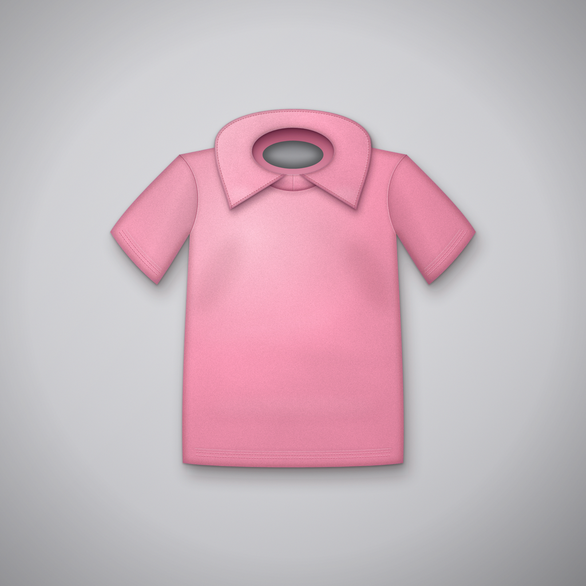

# Conceptshirt

Concept garment renders made entirely with code (no image-generation model).

## Pink collared tee



A solid pink short-sleeve t-shirt body (smooth jersey cotton, seamless front,
no ribbed neckline) fused at the neckline with a crisp spread dress-shirt
collar in matching pink poplin. No buttons, buttonholes, or placket: the
collar band simply closes at center front. Flat lay, front view, studio
lighting, minimalist gray backdrop.

Outputs in `output/`:

- `pink_collar_tee.png` – 2048 x 2048 master
- `pink_collar_tee.jpg` – same, JPEG
- `pink_collar_tee_preview.png` – 1024 x 1024 preview

## How it is made

`concept-tee/build.py` builds the whole picture procedurally:

1. An SVG scene is generated from a parametric garment model (tee outline,
   sleeves, armhole seams, folded hems with double-needle stitching, collar
   band, collar leaf with edge stitching, neck opening), with studio-light
   gradients, drop/contact shadows and fabric-edge shading.
2. The scene plus a region mask are rendered with headless Chromium
   (`concept-tee/render.cjs`, Playwright).
3. Python/NumPy adds fabric: a jersey-knit wale/course pattern on the body,
   a fine plain-weave texture on the collar, soft cloth undulation and grain.

Regenerate with:

```bash
cd concept-tee
python3 build.py            # writes ../output/*
python3 build.py --size 4096
```

Requirements: Python 3 with NumPy and Pillow, Node.js with Playwright and a
Chromium build it can launch. The vector scene itself is saved as
`concept-tee/pink_collar_tee.svg`.
